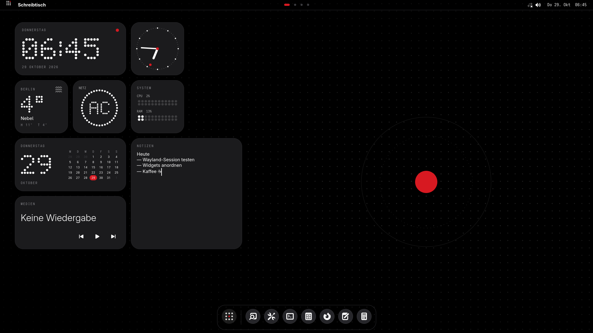
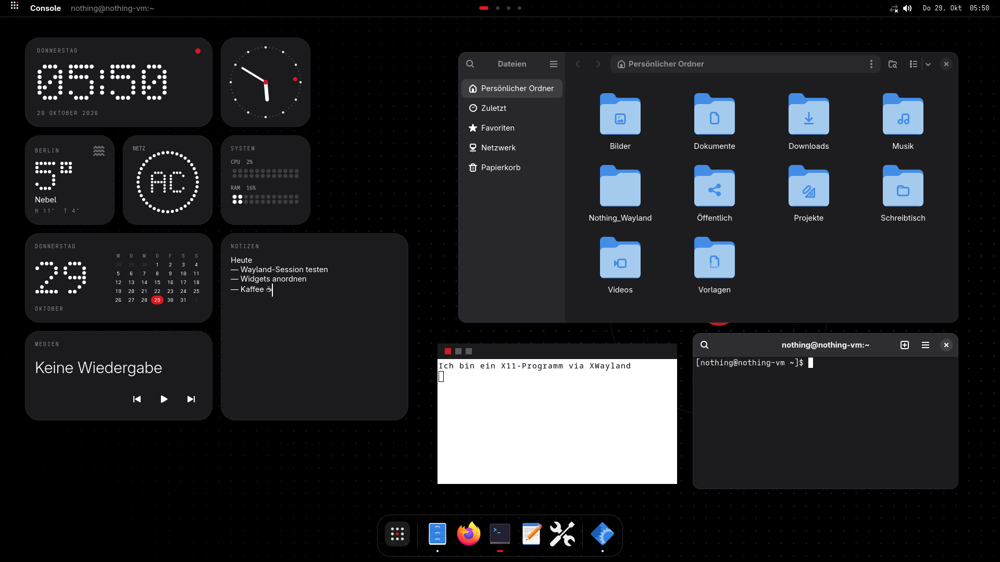
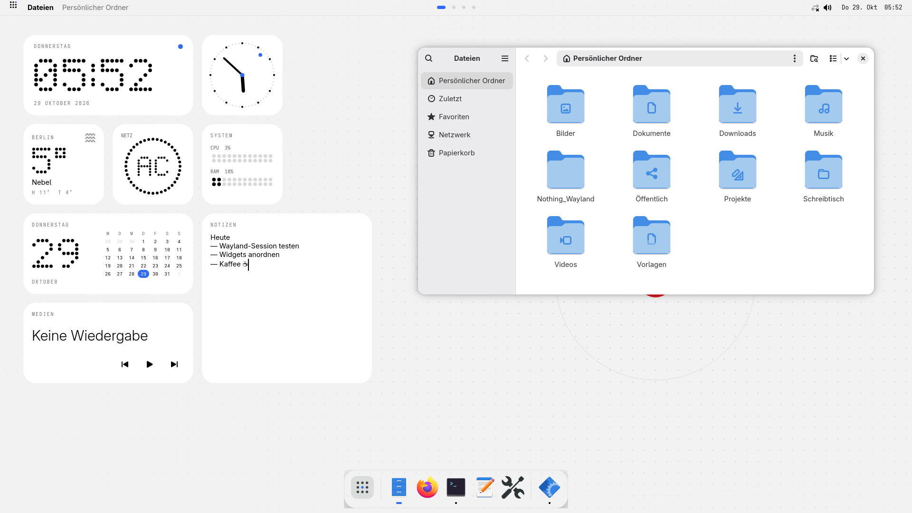
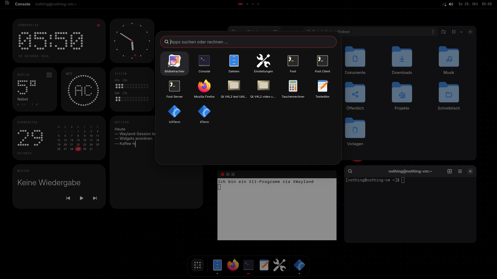
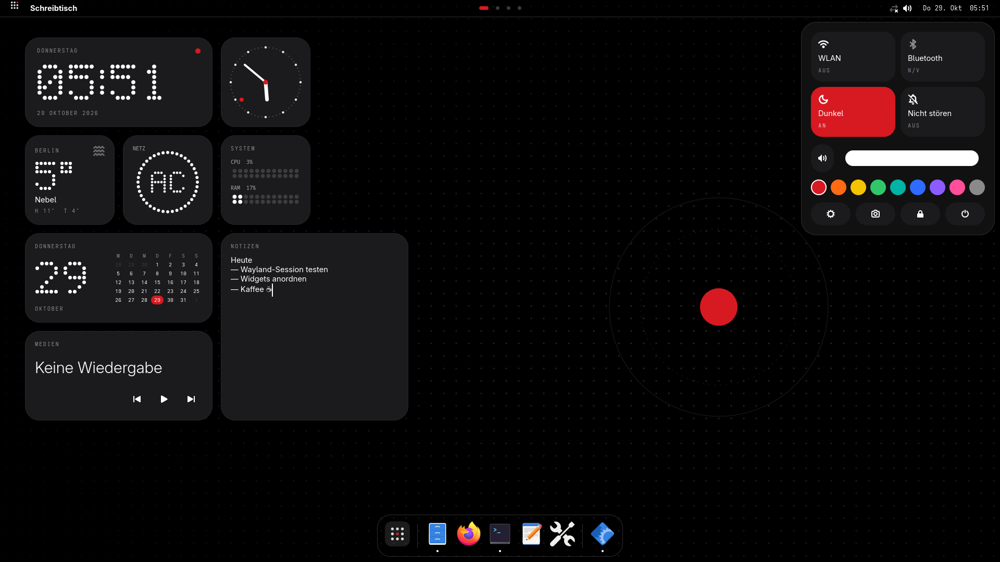
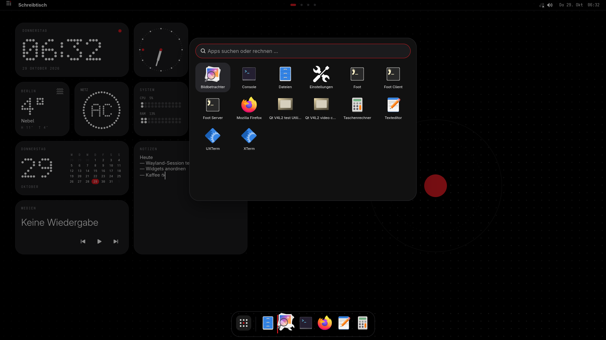
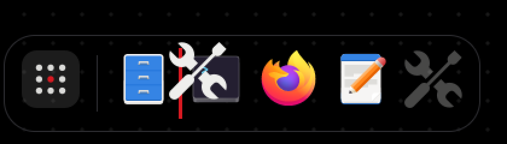
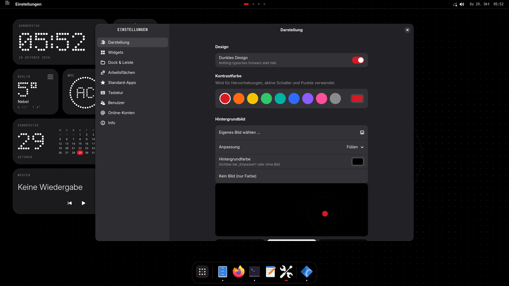
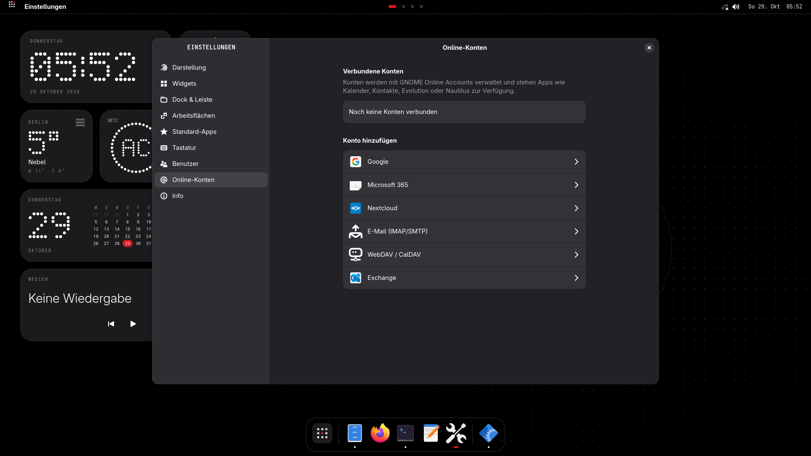

# Nothing Desktop

Eine Wayland-Desktopumgebung im Stil von **Nothing OS**. Sie ist aufgebaut wie macOS: oben eine Leiste,
unten ein Dock und dazwischen ein Schreibtisch mit Widgets. X11-Programme laufen über **XWayland**.



| Fenster (Wayland + X11) | Helles Design, blaue Kontrastfarbe |
|---|---|
|  |  |
| **App-Suche** (Super + Leertaste) | **Kontrollzentrum** (Super + A) |
|  |  |
| **App aus der Suche ins Dock ziehen** | **Im Dock umsortieren** (rote Linie = Ablagestelle) |
|  |  |
| **Einstellungen** | **Online-Konten** (Google, Microsoft, Nextcloud …) |
|  |  |

Weitere Bilder: [Sperrbildschirm](docs/screenshots/lock.png) · [Rechtsklick-Menü](docs/screenshots/menu.png) ·
[Rechner in der Suche](docs/screenshots/calc.png) · [Widgets](docs/screenshots/settings-widgets.png) ·
[Dock & Leiste](docs/screenshots/settings-dock.png) · [Standard-Apps](docs/screenshots/settings-apps.png) ·
[Benutzer](docs/screenshots/settings-users.png) · [Info](docs/screenshots/settings-about.png)

## Funktionen

- **Eigener Wayland-Compositor** (`nothing-wm`, C, wlroots 0.20) mit XWayland, virtuellen Arbeitsflächen,
  Drag & Drop zwischen Apps, Sperrbildschirm (ext-session-lock), Bildschirmfotos (screencopy) und
  Zwischenablage-Protokollen.
- **Design im Nothing-Stil:** Schwarz/Weiß, Punktmatrix-Ziffern (selbst gezeichnet, keine Schriftart nötig),
  runde Karten, Beschriftungen in Monospace-Großbuchstaben. Helles und dunkles Design.
- **Wählbare Kontrastfarbe:** neun Vorgaben oder eine eigene Farbe. Sie gilt für Shell, X11-Titelleisten und
  libadwaita-Apps.
- **Hintergrundbild:** mitgelieferte Nothing-Motive, Systemhintergründe oder ein eigenes Bild.
- **Widgets:** Uhr (Punktmatrix), Analoguhr, Wetter (open-meteo, ohne Konto), Akku, System (CPU/RAM),
  Kalender, Notizen, Medien (MPRIS) und Foto. Sie lassen sich frei verschieben.
- **Leiste:** Systemmenü, Name der aktiven App mit Fenstermenü, Punkte für die Arbeitsflächen, Netzwerk,
  Lautstärke, Akku, Uhr mit Kalender.
- **Dock:** angeheftete und laufende Apps, nach App gruppiert, mit Punkt für laufende Apps und Kontrastfarbe für
  die aktive. Anheften und Sortieren geht direkt, ohne Einstellungen:
  - Symbole im Dock **per Ziehen umsortieren**; eine Linie in Kontrastfarbe zeigt die Ablagestelle
  - Apps aus der **App-Suche ins Dock ziehen** oder dort per **Rechtsklick → „Im Dock behalten“** anheften
  - laufende Apps per Rechtsklick anheften; „Nach links/rechts verschieben“ und „Aus dem Dock entfernen“
  - bei vielen Apps werden die Symbole automatisch kleiner, damit alles auf den Bildschirm passt
- **Kontrollzentrum:** WLAN, Bluetooth, Dunkelmodus, *Nicht stören*, Lautstärke, Helligkeit, Kontrastfarbe, Ein/Aus.
- **Einstellungs-App:** Darstellung, Widgets, Dock und Leiste, Arbeitsflächen, Standard-Apps, Tastatur,
  Benutzer (AccountsService) und Online-Konten (GNOME Online Accounts).
- **Benachrichtigungen** (`org.freedesktop.Notifications`).

## Installation (Arch Linux)

```sh
./install.sh --deps      # Abhängigkeiten per pacman (wlroots0.20, gtk4-layer-shell, …)
./install.sh             # bauen und nach /usr/local installieren
# oder als Paket:
makepkg -si
```

Danach abmelden und im Anmeldebildschirm (GDM/SDDM) die Sitzung **Nothing** wählen.

Ausprobieren ohne Abmelden, als Fenster innerhalb einer laufenden Wayland-Sitzung:

```sh
WLR_BACKENDS=wayland nothing-wm -s nothing-shell
```

> In diesem Modus ändert ein Wechsel von Kontrastfarbe oder Hell/Dunkel auch die GNOME-Einstellungen der
> umgebenden Sitzung, denn darüber folgen libadwaita-Apps dem Design.

## Tastenkürzel

| Kürzel | Aktion |
|---|---|
| Super + Leertaste | Apps und Suche (mit Rechner: `12*7`) |
| Super + A | Kontrollzentrum |
| Super + Eingabe / E / , | Terminal / Dateien / Einstellungen |
| Super + 1 … 0 | Arbeitsfläche wechseln |
| Super + Umschalt + 1 … 0 | Fenster auf Arbeitsfläche verschieben |
| Super + Strg + ← / → | Vorherige / nächste Arbeitsfläche |
| Super + Q / F / M | Schließen / Vollbild / Minimieren |
| Super + ↑ / ↓ | Maximieren / Wiederherstellen |
| Super + Ziehen links / rechts | Fenster verschieben / Größe ändern |
| Super + D | Schreibtisch anzeigen |
| Super + L | Sperren |
| Alt + Tab | Fenster wechseln |
| Druck | Bildschirmfoto (`grim`) |
| Super + Umschalt + Esc | Abmelden |

Eigene Kürzel und Skripte steuern den Compositor über `nothing-msg`, siehe [IPC](docs/IPC.md).

## Dokumentation

| Seite | Inhalt |
|---|---|
| [Architektur](docs/ARCHITEKTUR.md) | Wie Compositor, Shell und Einstellungen zusammenspielen |
| [Konfiguration](docs/KONFIGURATION.md) | Alle Schlüssel von `config.json`, Umgebungsvariablen, Dateipfade |
| [IPC](docs/IPC.md) | Socket-Protokoll und `nothing-msg` |
| [Entwicklung & Tests](docs/ENTWICKLUNG.md) | Bauen, Code-Aufbau, Testen ohne Bildschirm und in einer VM |

## Stand und Grenzen

Getestet unter Arch Linux in einer QEMU/KVM-VM: Sitzung auf DRM, Wayland- und X11-Apps, Tastenkürzel,
Maus, Sperrbildschirm, Dock, App-Suche, Kontrollzentrum und Einstellungen. Ton, Bluetooth und WLAN konnten
mangels Hardware in der VM nicht geprüft werden, ebenso wenig ein echter Google-Login.

- Zum **Hinzufügen** von Google- oder Microsoft-Konten öffnet sich `gnome-control-center online-accounts`,
  weil GNOMEs Anmeldedialog nur dort steckt. Auflisten, Dienste schalten und Entfernen geht direkt in den
  Nothing-Einstellungen.
- Es gibt keine Bildschirmverwaltung in der Oberfläche. Mehrere Monitore werden automatisch nebeneinander
  gesetzt. HiDPI stellst du über `NOTHING_WM_SCALE` ein.
- X11-Fenster bekommen eine schlichte Titelleiste mit drei Knöpfen und ohne Titeltext.
- Fenster lassen sich nicht kacheln.

## Lizenz

MIT, siehe [LICENSE](LICENSE). `compositor/protocols/wlr-layer-shell-unstable-v1.xml` stammt aus
[wlr-protocols](https://gitlab.freedesktop.org/wlroots/wlr-protocols) und hat eigene Copyright-Angaben im Kopf.
„Nothing“ und Nothing OS sind Marken von Nothing Technology Ltd. Dieses Projekt ist eine inoffizielle
Hommage an deren Design und steht in keiner Verbindung zu dem Unternehmen.
