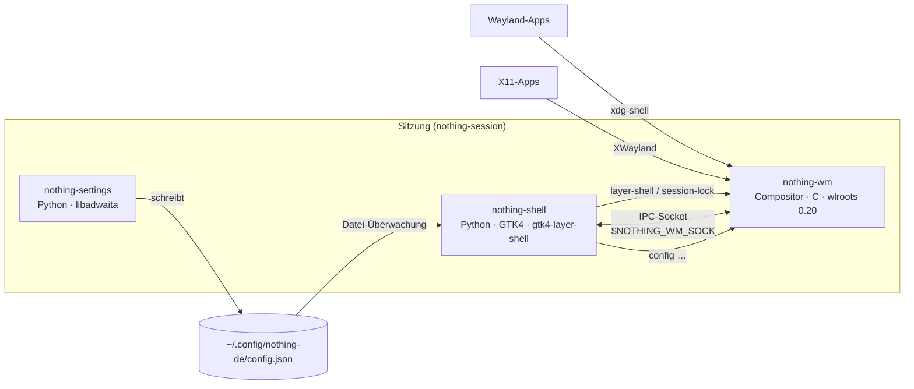

# Architektur

Der Nothing Desktop besteht aus drei Programmen. Sie tauschen sich über einen Unix-Socket und eine
gemeinsame JSON-Datei aus.

## Sitzungsstart

1. Der Anmeldebildschirm startet `nothing-session` (`data/sessions/nothing.desktop`). Das Skript setzt
   Umgebungsvariablen wie `XDG_CURRENT_DESKTOP=Nothing` und Toolkit-Hinweise für Qt, SDL und Electron.
   Außerdem liest es Tastaturbelegung und Anzahl der Arbeitsflächen aus der Konfiguration.
2. `nothing-wm -s nothing-session-start` startet den Compositor. Sobald das Wayland-Socket bereit ist,
   führt er das Startkommando aus und übergibt `WAYLAND_DISPLAY`, `DISPLAY`, `NOTHING_WM_SOCK` und
   `NOTHING_WM_PID`.
3. `nothing-session-start` exportiert diese Variablen an D-Bus und systemd, startet den Polkit-Agenten und
   den Schlüsselbund und hält `nothing-shell` am Leben. Stürzt die Shell ab, startet die Schleife sie neu,
   und zwar nur so lange, wie *ihr* Compositor läuft (`NOTHING_WM_PID`).

## Compositor (`compositor/nothing-wm.c`)

Eine einzige C-Datei auf Basis von wlroots 0.20 und dessen Szenengraph (`wlr_scene`).

**Ebenen im Szenengraph**, von unten nach oben:

| Ebene | Inhalt |
|---|---|
| `LYR_BACKGROUND` | layer-shell „background“: Schreibtisch mit Wallpaper und Widgets |
| `LYR_BOTTOM` | layer-shell „bottom“ |
| `LYR_WINDOWS` | ein Teilbaum je Arbeitsfläche (`ws_tree[0..9]`); nur der aktive ist eingeschaltet |
| `LYR_TOP` | layer-shell „top“: Leiste und Dock, dazu Popups unterer Ebenen |
| `LYR_UNMANAGED` | X11-Override-Redirect-Fenster (Menüs, Tooltips) |
| `LYR_FULLSCREEN` | Vollbildfenster, damit sie über Leiste und Dock liegen |
| `LYR_OVERLAY` | layer-shell „overlay“: App-Suche, Kontrollzentrum, Benachrichtigungen |
| `LYR_DRAG` | Symbol beim Drag & Drop; folgt dem Mauszeiger und ist von der Treffersuche ausgenommen |
| `LYR_LOCK` | Sperrbildschirm (schwarzer Hintergrund plus Lock-Surfaces) |

**Fenster** (`struct view`) sind entweder xdg-Toplevels oder XWayland-Fenster. `v->x`/`v->y` ist immer die
linke obere Ecke des *sichtbaren* Fensters. Die Schatten von CSD-Fenstern gleicht der xdg-Szenenbaum von
wlroots selbst aus. X11-Fenster ohne eigene Dekoration bekommen eine schlichte Titelleiste aus
`wlr_scene_rect`s (drei Knöpfe, der Schließen-Knopf in der Kontrastfarbe). Wayland-Apps zeichnen ihre
Dekoration selbst.

**Arbeitsflächen:** Jedes Fenster gehört zu einer Arbeitsfläche (`v->ws`). Ein Wechsel schaltet nur Teilbäume
um. Vollbildfenster liegen in `LYR_FULLSCREEN`, ihre Sichtbarkeit wird deshalb einzeln gesetzt
(`view_set_visible`).

**Fokus:** `server.views` ist nach dem zuletzt fokussierten Fenster sortiert. Layer-Surfaces mit
`keyboard_interactivity = exclusive` (App-Suche, Kontrollzentrum) behalten die Tastatur, bis sie sich
schließen. Bei aktivem Sperrbildschirm erhalten nur Lock-Surfaces Eingaben.

**Prozesse:** Programme startet der Compositor über einen Double-Fork. `SIGCHLD` bleibt absichtlich auf dem
Standardwert. Ein ignoriertes `SIGCHLD` würde vererbt und bricht dann z. B. Xwaylands Aufruf von `xkbcomp`.

**Drag & Drop:** `request_start_drag` wird gegen die Seriennummer des Pointer-Grabs geprüft, danach
übernimmt `wlr_seat_start_pointer_drag`. Unter Wayland läuft jedes Ziehen über den Compositor, auch
innerhalb einer App, also auch das Umsortieren im Dock.

**Weitere Protokolle:** Zwischenablage (data-device, primary-selection, wlr/ext-data-control), Viewporter,
Presentation-Time, Fractional-Scale, Cursor-Shape, xdg-activation, screencopy, ext-image-copy-capture,
export-dmabuf, gamma-control, idle-notify und idle-inhibit, xdg-output, Relative-Pointer.

## Shell (`shell/nothing_de/`)

| Modul | Aufgabe |
|---|---|
| `shell.py` | Einstiegspunkt: erzeugt Fenster je Monitor, verarbeitet Aktionen, XDG-Autostart |
| `ipc.py` | Client für den Compositor-Socket (`state`- und `action`-Ereignisse) |
| `config.py` | Laden, Speichern und Überwachen von `config.json`, Standardwerte |
| `theme.py` | Erzeugt das CSS aus Palette und Kontrastfarbe und synchronisiert GNOMEs `color-scheme`/`accent-color` |
| `layer.py` | Hilfen für gtk4-layer-shell, `Overlay` (Vollbild-Ebene mit schwebendem Panel) |
| `bar.py` | Leiste oben |
| `dock.py` | Dock: Gruppierung, Ziehen zum Umsortieren und Anheften, automatische Symbolgröße |
| `desktop.py` | Hintergrund und Widget-Fläche (Verschieben, Rechtsklick-Menü) |
| `widgets.py` | Die Widgets |
| `dotmatrix.py` | Punktmatrix-Schrift (5×7) mit cairo |
| `launcher.py` | App-Suche mit Rechner; Kacheln lassen sich ins Dock ziehen oder per Rechtsklick anheften. Das Overlay lässt den Bereich des Docks frei |
| `control.py` | Kontrollzentrum |
| `notifications.py` | Benachrichtigungsdienst |
| `lockscreen.py` | Sperrbildschirm über `Gtk4SessionLock`; das Passwort prüft `unix_chkpwd` |
| `system.py` | Lautstärke (wpctl/pactl), Helligkeit (logind), Netzwerk (NM), Bluetooth, Energie (logind) |
| `apps.py` | Index der `.desktop`-Dateien: ordnet App-IDs und X11-Klassen den Apps zu |
| `settings.py` | Die Einstellungs-App (eigener Prozess) |

`bin/nothing-shell` lädt `libgtk4-layer-shell.so` per `LD_PRELOAD`. Das ist nötig, weil die Bibliothek
vor `libwayland-client` geladen werden muss.

## Datenfluss bei einer Einstellung

1. Die Einstellungs-App schreibt `config.json` atomar (temporäre Datei, dann `os.replace`).
2. Die Shell bemerkt die Änderung über `Gio.FileMonitor`, lädt neu und sendet `changed`.
3. Theme, Widgets, Dock und Leiste aktualisieren sich. `push_wm_config` gibt Arbeitsflächen,
   Tastaturbelegung, Kontrastfarbe und Hell/Dunkel per IPC an den Compositor weiter.
